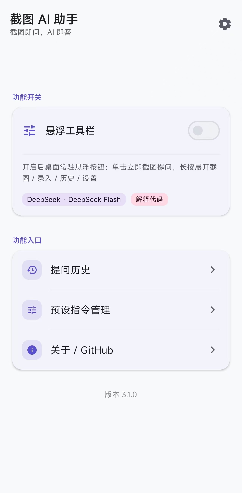
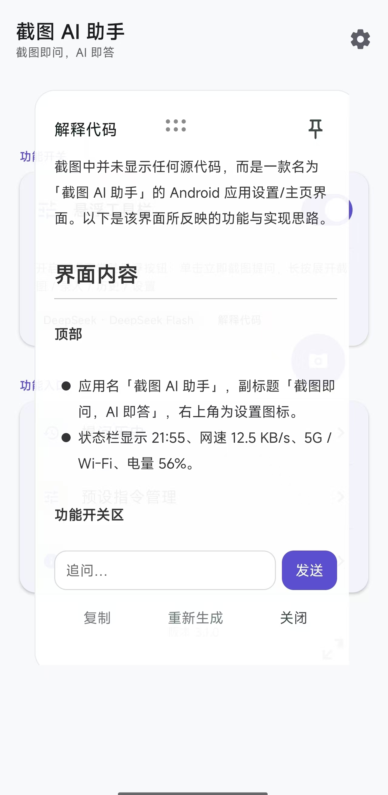
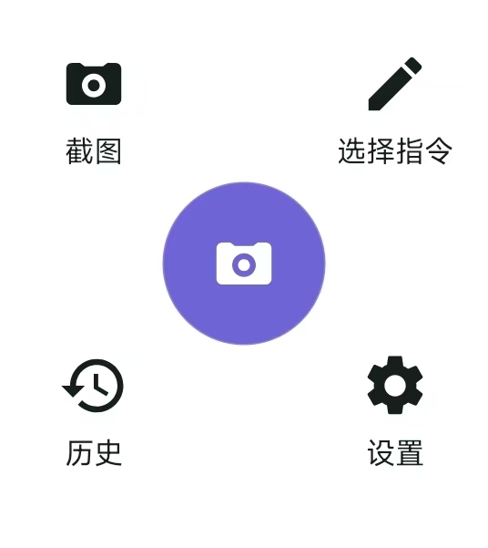
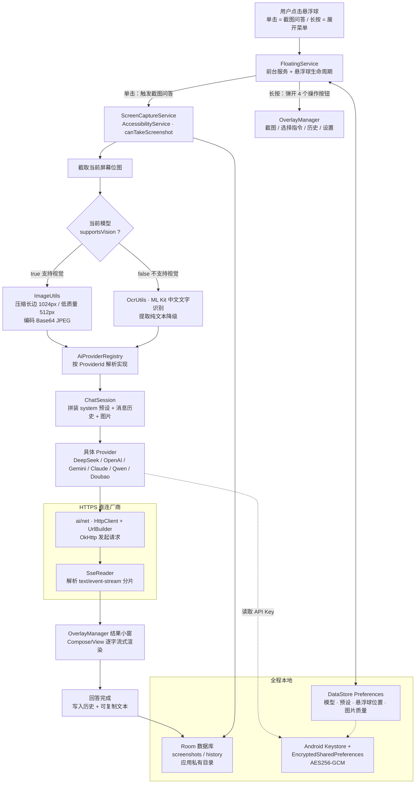

# [English](README_EN.md) | 简体中文
# Screenshot AI · 截图 AI 助手

> 一个常驻桌面的 Android 悬浮球：**点一下截图，AI 流式解答**。截图 → 发送给大模型 → 答案逐字出现在悬浮小窗里，不打断你正在做的事。
## 😋😋😋点击立即下载------>[](https://github.com/MapleYazuu/Screenshot-Ai/releases)<------点击立即下载😋😋😋
[](LICENSE)
[-3DDC84.svg?logo=android&logoColor=white)](https://developer.android.com/about/versions/11)
[](https://kotlinlang.org/)
[](https://developer.android.com/jetpack/compose)
[](https://github.com/MapleYazuu/Screenshot-AI/actions/workflows/android.yml)
[](https://github.com/MapleYazuu/Screenshot-Ai/releases)

<!--
  CI 徽章由 .github/workflows/android.yml 在 push 到 main 后自动生成。
  仓库地址同时被 app 的「检查更新」功能使用，定义在
  app/src/main/java/com/screenshot/ai/util/UpdateChecker.kt 的 GITHUB_OWNER / GITHUB_REPO，
  改名时请同步修改这三处。
-->

**Screenshot AI（截图 AI 助手）** 是一个开源的 Android **桌面常驻悬浮按钮**形式的截图 AI 助手。它不做云端中转、没有账号体系、不收集任何用户数据 —— 你填入自己的 API Key，截图直接从手机发往你自己选择的模型厂商（BYOK，Bring Your Own Key）。

---

## 目录

- [功能特性](#功能特性)
- [演示](#演示)
- [架构](#架构)
- [技术栈](#技术栈)
- [项目结构](#项目结构)
- [编译指南](#编译指南)
- [首次使用 / 权限配置](#首次使用--权限配置)
- [API Key 配置说明 (BYOK)](#api-key-配置说明-byok)
- [内置预设指令](#内置预设指令)
- [权限说明](#权限说明)
- [常见问题 FAQ](#常见问题-faq)
- [参与贡献](#参与贡献)
- [开源协议](#开源协议)
- [致谢](#致谢)

---

## 功能特性

### 核心交互：单击截图，长按展开菜单

悬浮球一直在屏幕上，只有两种操作方式，不需要记任何手势：

| 操作 | 行为 |
| --- | --- |
| **单击悬浮球** | 立即截取当前屏幕 → 用**当前预设指令**发给 AI → 答案**流式**渲染进悬浮结果小窗 |
| **长按悬浮球** | 弹开 4 个操作按钮：**截图 Capture** / **选择指令 Preset** / **历史 History** / **设置 Settings** |
| **拖拽悬浮球** | 自由移动到屏幕任意边缘，位置会被记住 |

长按后的 4 个动作：

| 按钮 | 说明 |
| --- | --- |
| **截图 Capture** | 手动触发一次截图 + AI 问答，等价于单击悬浮球 |
| **选择指令 Preset** | 打开预设指令列表，点选即设为默认指令（列表底部可「+ 新建指令」） |
| **历史 History** | 打开 Room 历史记录页，回看历次提问、截图缩略图与 AI 回答 |
| **设置 Settings** | 悬浮球外观、预设指令、模型与 API Key、图片质量、开机自启等 |

## 📱 界面预览

| 主页 |  演示 | 按钮 | 按钮展开 | 软件图标 |
| :---: | :---: | :---: | :---: | :---: |
|  |  |  |  |  |

```text
docs/images/
├── home.jpg          # 主界面
├── effect.jpg        # 效果演示
├── button.jpg        # 悬浮球按钮
├── buttonunfold.jpg  # 长按展开的 4 个操作按钮
├── icon.png          # 软件图标
└── README.md         # 演示截图 / GIF 的提交约定
```

### 功能清单

- 🎈 **桌面常驻悬浮球** —— 前台服务保活，不占用最近任务，随时可用。
- 📸 **一键截图** —— 通过无障碍服务 `canTakeScreenshot="true"` 截取当前屏幕，无需 root、无需弹系统授权框。
- 🖼️ **多模态直发** —— 支持视觉的模型直接接收 Base64 JPEG 图片（长边最大 1024px，低质量模式 512px）。
- 🔤 **本地 OCR 降级** —— 不支持视觉的模型自动改用 **ML Kit 中文文字识别**，把提取出的文字发给模型，纯文本模型也能用。
- ⚡ **SSE 流式输出** —— 基于 OkHttp 手写 SSE 解析，答案逐字上屏，不用等整段生成完。
- 🔌 **BYOK 多厂商** —— 内置 **6 家** Provider（DeepSeek / OpenAI / Google Gemini / Anthropic Claude / 通义千问 / 豆包），全部支持自定义 Base URL。
- 🧩 **预设指令** —— 内置 5 条预设（翻译 / 总结 / 解释代码 / 提取文字 / 解题答疑），可自行增删改，默认使用第一条。
- 🗂️ **Room 历史** —— 每次问答（问题、截图、回答、模型、时间）本地落库，可检索、可回看、可删除。
- ⚙️ **DataStore 配置** —— 所有偏好（模型、预设、悬浮球位置、图片质量、流式开关）基于 DataStore Preferences。
- 🔐 **密钥加密** —— API Key 经 Android Keystore 主密钥 **AES256-GCM** 加密后写入 EncryptedSharedPreferences，明文永不落盘。
- 🚫 **隐私优先** —— 截图只写入应用私有目录 `filesDir/screenshots`，**不进相册**；Manifest 中禁用备份。
- 🌙 **Compose 主界面** —— 主界面 / 历史 / 预设 / 设置 / 关于全部用 Jetpack Compose 编写，跟随系统深色模式。
- 🚀 **可选开机自启** —— `RECEIVE_BOOT_COMPLETED` 可选开启，重启后自动恢复悬浮球。
- 🔋 **电池优化白名单** —— 一键跳转 `REQUEST_IGNORE_BATTERY_OPTIMIZATIONS`，降低被系统杀后台的概率。
- 🔄 **更新检查** —— 内置 `UpdateChecker`，可检查新版本（不自动下载、不静默安装）。

---

## 架构



数据流要点：

1. **截图**：`FloatingService` 单击 → 调起 `ScreenCaptureService`（无障碍服务，声明 `canTakeScreenshot="true"`）→ 拿到当前屏幕 `Bitmap`。
2. **按模型能力分流**：`AiModel.supportsVision == true` 走 `ImageUtils` 压缩 + Base64；否则走 `OcrUtils`（ML Kit 中文识别）把文字当输入。
3. **请求**：`AiProviderRegistry` 按当前 `ProviderId` 取到实现 → `ChatSession` 把预设提示词、历史上下文和图片装进 `ChatMessage` → `HttpClient` 发出请求。
4. **流式回显**：`SseReader` 逐块解析 `text/event-stream`，`OverlayManager` 把增量文本推给小窗，实现逐字输出。
5. **落库**：结果小窗完成后写 Room；配置变更写 DataStore；API Key 只以密文形式存在于 EncryptedSharedPreferences。

除 `ai/net/` 发出的 HTTPS 请求外，**没有任何数据离开设备**。

---

## 技术栈

| 模块 | 技术选型 |
| --- | --- |
| 开发语言 | Kotlin 2.0.21 |
| 主界面 UI | Jetpack Compose（Material 3，深色模式） |
| 悬浮窗 UI | 传统 View + XML + `WindowManager`（`TYPE_APPLICATION_OVERLAY`） |
| 截图能力 | `AccessibilityService` + `takeScreenshot`（`canTakeScreenshot="true"`） |
| 网络 | OkHttp + 手写 SSE 流式解析（`SseReader`） |
| 历史持久化 | Room |
| 配置存储 | DataStore（Preferences） |
| 密钥安全 | Android Keystore（AES256-GCM）+ EncryptedSharedPreferences |
| 本地 OCR | ML Kit 中文文字识别（非视觉模型降级方案） |
| 图片加载 | Coil |
| 构建系统 | Gradle Kotlin DSL + Version Catalog（`gradle/libs.versions.toml`） |
| 注解处理 | KSP 2.0.21-1.0.28 |
| 构建工具链 | AGP 8.5.2 / Gradle 8.9 / JDK 17 |
| 版本范围 | minSdk 30（Android 11）/ targetSdk 34 / compileSdk 34 |
| 许可证 | GNU General Public License v3.0 |

---

## 项目结构

```text
screenshot-ai/
├── app/
│   └── src/
│       ├── main/
│       │   ├── java/com/screenshot/ai/
│       │   │   ├── ScreenshotAiApp.kt        # Application：初始化应用级依赖
│       │   │   ├── ServiceLocator.kt         # 轻量依赖装配（DB / Repo / Prefs）
│       │   │   ├── ai/                       # AI 抽象层
│       │   │   │   ├── AiProvider.kt         # Provider 接口（chatStream / testConnection）
│       │   │   │   ├── AiModel.kt            # 模型描述（id / 展示名 / supportsVision / 上下文窗口）
│       │   │   │   ├── ChatMessage.kt        # 消息模型（system / user / assistant + 图片 Base64）
│       │   │   │   ├── ChatSession.kt        # 会话编排与取消
│       │   │   │   ├── StreamCallback.kt     # 流式回调（onStart / onChunk / onComplete / onError）
│       │   │   │   ├── AiException.kt        # 统一异常（HttpError / NetworkError / ParseError …）
│       │   │   │   ├── AiProviderRegistry.kt # Provider 注册与 (Provider, Model) 解析
│       │   │   │   ├── net/                  # HttpClient.kt · UrlBuilder.kt · SseReader.kt
│       │   │   │   └── providers/            # 6 个内置 Provider + OpenAI 兼容基类 + 自定义模型
│       │   │   │       ├── OpenAiCompatibleProvider.kt  # 兼容协议基类（请求拼装 / 鉴权 / SSE 解析）
│       │   │   │       ├── DeepSeekProvider.kt
│       │   │   │       ├── OpenAiProvider.kt
│       │   │   │       ├── GeminiProvider.kt
│       │   │   │       ├── AnthropicProvider.kt         # 唯一独立实现：/v1/messages
│       │   │   │       ├── QwenProvider.kt
│       │   │   │       ├── DoubaoProvider.kt
│       │   │   │       └── CustomProvider.kt            # 自定义模型（BYOK 自建网关）
│       │   │   ├── service/                  # 后台常驻服务
│       │   │   │   ├── FloatingService.kt        # 悬浮球前台服务
│       │   │   │   ├── ScreenCaptureService.kt   # 无障碍截图服务（canTakeScreenshot）
│       │   │   │   ├── OverlayManager.kt         # 所有悬浮窗口的创建与调度
│       │   │   │   ├── FloatingToolbarTileService.kt   # 下拉快捷开关（Quick Settings Tile）
│       │   │   │   ├── FloatingServiceController.kt    # 悬浮工具栏启停统一入口
│       │   │   │   └── BootReceiver.kt           # 开机自启（可选）
│       │   │   ├── overlay/                  # 悬浮窗 View（统一手势底座 WindowGestureBinder）
│       │   │   │   ├── OverlayBubbleView.kt          # 悬浮球本体
│       │   │   │   ├── OverlayBubbleContainerView.kt # 悬浮球窗口容器
│       │   │   │   ├── OverlayActionPanelView.kt     # 长按展开的 4 个操作按钮（独立窗口）
│       │   │   │   ├── OverlayResultWindowView.kt    # 流式结果小窗（Markdown 渲染 + 追问）
│       │   │   │   ├── OverlayHistoryPanelView.kt    # 悬浮历史 / 选择指令面板
│       │   │   │   ├── OverlayCapturePreviewView.kt  # 截图预览
│       │   │   │   ├── OverlayPresetCreateView.kt    # 「新建指令」二级弹窗
│       │   │   │   ├── WindowGestureBinder.kt        # 拖拽 / 缩放统一手势状态机
│       │   │   │   └── MaxHeightScrollView.kt        # 高度自适应滚动容器
│       │   │   ├── ui/                       # Compose 主界面
│       │   │   │   ├── main/                 # MainActivity / MainScreen / MainViewModel
│       │   │   │   ├── history/              # HistoryActivity / HistoryScreen / HistoryViewModel
│       │   │   │   ├── preset/               # PresetActivity / PresetScreen / PresetViewModel
│       │   │   │   ├── settings/             # SettingsActivity / SettingsScreen / SettingsViewModel
│       │   │   │   ├── about/                # AboutActivity / AboutScreen / AboutViewModel
│       │   │   │   ├── theme/                # Theme.kt · Shape.kt · Type.kt
│       │   │   │   └── common/               # CommonComponents.kt · LifecycleAwareDialog.kt
│       │   │   ├── data/                     # 数据层
│       │   │   │   ├── db/                   # AppDatabase.kt · HistoryDao.kt · HistoryRepositoryImpl.kt
│       │   │   │   ├── preset/               # PresetDao.kt · PresetRepositoryImpl.kt
│       │   │   │   ├── image/                # ImageStoreImpl.kt（写入 filesDir/screenshots）
│       │   │   │   ├── crypto/               # CryptoRepository.kt · CryptoRepositoryImpl.kt（Keystore）
│       │   │   │   ├── prefs/                # AppSettings.kt · SettingsRepository.kt（DataStore）
│       │   │   │   ├── model/                # HistoryItem.kt · Preset.kt
│       │   │   │   └── repo/                 # HistoryRepository.kt · ImageStore.kt · PresetRepository.kt
│       │   │   └── util/                     # 工具集
│       │   │       ├── ImageUtils.kt            # 缩放 / 压缩 / Base64 编码
│       │   │       ├── OcrUtils.kt              # ML Kit 中文文字识别
│       │   │       ├── PermissionUtils.kt       # 悬浮窗 / 通知 / 电池白名单跳转
│       │   │       ├── FloatingDragListener.kt  # 悬浮球拖拽与吸边手势
│       │   │       ├── MarkdownRenderer.kt      # Markwon 富文本渲染统一出口
│       │   │       ├── Haptics.kt               # 轻触 / 长按振动反馈
│       │   │       ├── LocaleManager.kt         # 多语言切换
│       │   │       ├── AiErrorMessages.kt       # AI 异常 → 本地化文案
│       │   │       ├── PromptTemplates.kt       # 系统提示词模板
│       │   │       ├── UpdateChecker.kt         # 版本检查
│       │   │       ├── TimeUtils.kt             # 时间格式化
│       │   │       ├── ToastUtils.kt            # 统一提示
│       │   │       └── UiPx.kt                  # dp → px 统一换算
│       │   ├── res/                          # 资源：布局 XML / 图标 / 主题 / 多语言文案（zh/en/ja/ko/ru）
│       │   └── AndroidManifest.xml
│       └── test/java/com/screenshot/ai/      # 单元测试
│           ├── ai/ProviderRegistryTest.kt · ai/SseParserTest.kt
│           ├── data/PresetRepositoryLogicTest.kt · data/CustomModelConfigTest.kt
│           └── util/ImageUtilsTest.kt · TimeUtilsTest.kt · UpdateCheckerTest.kt
├── docs/
│   ├── byok.md              # BYOK 模式详解与成本控制
│   ├── adding-a-provider.md # 如何新增一个 AI Provider
│   ├── api-key-security.md  # API Key 安全策略与威胁模型
│   └── images/              # 演示截图与 GIF（见 docs/images/README.md）
├── gradle/
│   ├── libs.versions.toml   # Version Catalog
│   └── wrapper/             # Gradle 8.9 wrapper（默认腾讯云镜像）
├── .github/
│   ├── workflows/android.yml      # CI：Debug 构建 + 标签发布
│   ├── ISSUE_TEMPLATE/            # bug_report.yml · feature_request.yml · config.yml
│   └── PULL_REQUEST_TEMPLATE.md
├── CONTRIBUTING.md
├── LICENSE                  # GNU GPL v3.0
└── README.md
```

---

## 编译指南

### 环境要求

| 项目 | 版本要求 |
| --- | --- |
| Android Studio | **Ladybug**（2024.2.1）或更新版本 |
| JDK | **17**（AGP 8.5.2 强制要求，JDK 21 亦可但请以 17 为准） |
| Android SDK Platform | **API 34**（compileSdk / targetSdk） |
| Android Build Tools | 34.x（由 AGP 自动下载） |
| Gradle | **8.9**（使用仓库自带 wrapper，无需手动安装） |
| 真机系统 | Android 11（API 30）及以上 |

> Android Studio 会自动下载所需的 SDK Platform 与 Build Tools。命令行编译请确保 `ANDROID_HOME`
> 或 `local.properties` 中的 `sdk.dir` 指向已安装 API 34 的 SDK 目录。

### 编译步骤

```bash
# 1. 克隆仓库
git clone https://github.com/MapleYazuu/Screenshot-AI.git screenshot-ai
cd screenshot-ai

# 2. 编译 Debug APK（Windows 用 gradlew.bat，macOS/Linux 用 ./gradlew）
./gradlew :app:assembleDebug

# 3. 运行单元测试
./gradlew :app:testDebugUnitTest
```

产物路径：

```text
app/build/outputs/apk/debug/app-debug.apk
```

安装到已连接的真机：

```bash
adb install -r app/build/outputs/apk/debug/app-debug.apk
```

> Debug 包的 `applicationId` 带 `.debug` 后缀（`com.screenshot.ai.debug`），因此可以和 Release
> 包同时安装在一台设备上，互不覆盖。

### Gradle 发行版镜像（中国大陆网络）

Gradle wrapper 默认从 `services.gradle.org` 下载发行版，国内网络经常超时。
**本仓库已经默认使用腾讯云镜像**，因此国内用户**无需任何额外配置**即可直接编译：

```properties
# gradle/wrapper/gradle-wrapper.properties
distributionBase=GRADLE_USER_HOME
distributionPath=wrapper/dists
distributionUrl=https\://mirrors.cloud.tencent.com/gradle/gradle-8.9-bin.zip
networkTimeout=10000
validateDistributionUrl=false
zipStoreBase=GRADLE_USER_HOME
zipStorePath=wrapper/dists
```

如果你在**海外**或希望改用 Gradle 官方源，把 `distributionUrl` 换成官方地址即可：

```properties
distributionUrl=https\://services.gradle.org/distributions/gradle-8.9-bin.zip
```

> ⚠️ 修改 `gradle-wrapper.properties` 属于本地环境调整，**请勿提交到 PR**
> —— CI 运行在 GitHub 的机器上，换源不影响它，但会让 diff 变脏。

如果依赖（Maven Central / Google Maven）也不稳定，可在 `settings.gradle.kts` 的
`dependencyResolutionManagement` 中追加国内镜像仓库。**同样请勿提交仅适用于本地网络的仓库配置**，
如需修改请另行说明并保证公共 CI 仍可构建。

---

## 首次使用 / 权限配置

按顺序完成以下 7 步即可开始使用：

1. **安装应用**
   `adb install -r app-debug.apk`，或直接点击已下载的 APK 安装。首次启动会进入主界面。

2. **授予悬浮窗权限（必需）**
   点击首页的「悬浮窗权限」引导项，跳转系统设置 → 允许「**显示在其他应用的上层**」
   （`SYSTEM_ALERT_WINDOW`）。没有这个权限，悬浮球根本不会出现。

3. **开启无障碍服务（必需）**
   点击「无障碍服务」引导项 → 系统设置 → 已安装的服务 → **Screenshot AI** → 开启。
   该服务声明了 `canTakeScreenshot="true"`，是**截图能力的唯一来源**。不开就无法截图。

4. **授予通知权限（Android 13+ 必需）**
   Android 13 及以上会弹窗请求 `POST_NOTIFICATIONS`。前台服务需要常驻通知，
   拒绝会导致服务不稳定甚至被系统回收。

5. **（可选）开机自启 + 电池优化白名单**
   - 在设置页开启「开机自启」，重启手机后悬浮球自动恢复（`RECEIVE_BOOT_COMPLETED`）。
   - 点击「忽略电池优化」，在系统弹窗中选择「允许」，减少后台被杀的概率。

6. **选择 Provider 并粘贴 API Key**
   设置页 → **AI Provider** → 从 6 家中选择一家 → 从下拉列表选择模型
   （带 👁 标记的表示支持视觉）→ 粘贴你的 API Key。
   Key 会立刻用 Android Keystore 加密，设置页只显示掩码，不会回显明文。
   各厂商 Key 的申请地址见 [API Key 配置说明 (BYOK)](#api-key-配置说明-byok)。

7. **测试连接**
   设置页 → 「**测试连接**」。成功会提示模型可用；失败会给出 HTTP 状态码。
   对照 [常见问题 FAQ](#常见问题-faq) 中的 401 / 429 说明排查即可。

配置完成后回到桌面，悬浮球应该已经在屏幕边缘待命了 —— **单击试试**。

---

## API Key 配置说明 (BYOK)

**BYOK = Bring Your Own Key。** 本项目不提供任何官方 API 额度，也不做请求中转，
你需要自己到厂商开放平台申请 Key，并自行承担调用费用。

| Provider | 申请地址 | 默认 Base URL | 内置模型是否支持视觉 |
| --- | --- | --- | --- |
| **DeepSeek** 深度求索 | <https://platform.deepseek.com/api_keys> | `https://api.deepseek.com/` | `deepseek-flash` ✅ 视觉<br/>`deepseek-chat` ❌ 纯文本<br/>`deepseek-reasoner` ❌ 纯文本 |
| **OpenAI** | <https://platform.openai.com/api-keys> | `https://api.openai.com/` | `gpt-4o` ✅ / `gpt-4o-mini` ✅ / `gpt-4-turbo` ✅<br/>`o3-mini` ❌ 纯文本 |
| **Google Gemini** | <https://aistudio.google.com/app/apikey> | `https://generativelanguage.googleapis.com/v1beta/openai/` | `gemini-1.5-flash` ✅ / `gemini-1.5-pro` ✅ / `gemini-2.0-flash` ✅ |
| **Anthropic Claude** | <https://console.anthropic.com/settings/keys> | `https://api.anthropic.com/` | `claude-3-5-sonnet-20241022` ✅ / `claude-3-5-haiku-20241022` ✅ / `claude-3-opus-20240229` ✅ |
| **通义千问 Qwen**（DashScope） | <https://bailian.console.aliyun.com/?apiKey=1> | `https://dashscope.aliyuncs.com/compatible-mode/v1/` | `qwen-vl-max` ✅ / `qwen-vl-plus` ✅<br/>`qwen-plus` ❌ 纯文本 |
| **豆包 Doubao**（火山方舟） | <https://console.volcengine.com/ark> | `https://ark.cn-beijing.volces.com/api/v3/` | `doubao-vision-pro-32k` ✅ / `doubao-vision-lite-32k` ✅<br/>`doubao-pro-32k` ❌ 纯文本 |

**协议差异**：除 Anthropic 走 `/v1/messages` 之外，其余 5 家都走 OpenAI 兼容的
`/chat/completions` 接口，因此新增同类厂商的成本很低
（见 [docs/adding-a-provider.md](docs/adding-a-provider.md)）。

**Base URL 会自动规整**：上表的默认地址开箱即用，无需手动补路径。`UrlBuilder` 会统一处理
末尾多余斜杠、版本段缺失等情况：

| 你填的内容 | 实际请求的地址 |
| --- | --- |
| `https://api.deepseek.com/` | `https://api.deepseek.com/v1/chat/completions` |
| `https://api.deepseek.com` | `https://api.deepseek.com/v1/chat/completions` |
| `https://api.deepseek.com/v1` | `https://api.deepseek.com/v1/chat/completions` |
| `https://my-gw.example.com/v1/` | `https://my-gw.example.com/v1/chat/completions` |
| `https://my-gw.example.com/v1/chat/completions` | 原样使用 |

所以自建网关只要填到**版本层即可**，填完整地址也不会被重复拼接。

### 关于密钥安全的说明

- ✅ API Key 在设备本地用 **Android Keystore 主密钥 + AES256-GCM** 加密后存入
  EncryptedSharedPreferences，**明文不落盘**。
- ✅ Key **不会**上传到本项目的任何服务器（本项目根本没有服务器）。
- ✅ Key 只会出现在发往**你自己所选厂商**的 HTTPS 请求头里。
- ⚠️ 换言之：**除了你配置的那家模型厂商，没有任何第三方能拿到你的 Key。**
- ⚠️ 已 root 的设备、被恶意应用注入的设备，本地加密的保护能力会显著下降。
  完整的威胁模型分析见 [docs/api-key-security.md](docs/api-key-security.md)。
- ⚠️ Manifest 中已**禁用云备份**（`allowBackup="false"`），因此密文也不会随系统备份外流。

更详细的申请步骤、额度说明、自定义 Base URL 用法与成本控制技巧，见
**[docs/byok.md](docs/byok.md)**。

---

## 内置预设指令

内置 5 条预设，**第一条「翻译」为默认预设**。可在设置页新增、编辑、删除、排序，
也可在悬浮菜单的「选择指令」里临时切换。

| # | 名称 | 作用 | 典型场景 |
| --- | --- | --- | --- |
| 1 | **翻译**（默认） | 识别截图中的全部文字并翻译成中文 | 英文文档、日文界面、外语 App |
| 2 | **总结** | 总结截图主要内容，提取关键信息 | 长文、公告、聊天记录快速抓重点 |
| 3 | **解释代码** | 说明截图中代码的功能与实现方式 | 看开源代码、读报错堆栈 |
| 4 | **提取文字** | 原样提取文字并保持段落格式，不做额外解读 | 复制不可选中的文字、票据信息 |
| 5 | **解题答疑** | 先给解题思路，再给详细步骤和最终答案 | 数学题、选择题、作业辅导 |

> 使用非视觉模型时，预设 1 / 4 依然可用 —— 输入会由 ML Kit 本地 OCR 提供。

---

## 权限说明

| 权限 | 用途 | 是否必需 |
| --- | --- | --- |
| `SYSTEM_ALERT_WINDOW` | 显示悬浮球、动作菜单与结果小窗（`TYPE_APPLICATION_OVERLAY`） | ✅ **必需** |
| `BIND_ACCESSIBILITY_SERVICE`<br/>（无障碍服务，`canTakeScreenshot="true"`） | 截取当前屏幕画面，截图能力的唯一来源 | ✅ **必需** |
| `FOREGROUND_SERVICE` | 以悬浮球前台服务形式常驻，避免被系统随时回收 | ✅ **必需** |
| `FOREGROUND_SERVICE_SPECIAL_USE` | Android 14 起前台服务必须声明具体类型 | ✅ **必需** |
| `POST_NOTIFICATIONS` | 展示前台服务常驻通知 | ✅ **必需**（Android 13+ 运行时申请） |
| `INTERNET` | 通过 HTTPS 访问你配置的 AI 厂商接口 | ✅ **必需** |
| `RECEIVE_BOOT_COMPLETED` | 开机后自动恢复悬浮球 | ⭕ 可选（设置页开关） |
| `REQUEST_IGNORE_BATTERY_OPTIMIZATIONS` | 引导加入电池优化白名单，降低后台被杀概率 | ⭕ 可选 |
| `QUERY_ALL_PACKAGES` | 跳转各厂商设置页时查询组件可见性 | ✅ 已声明（带 `tools:ignore`） |

**不申请**的权限（可自行核对 `AndroidManifest.xml`）：读写外部存储 / 相册、读取通讯录、定位、
读取短信、`READ_LOGS` 等。截图全程只写应用私有目录。

---

## 常见问题 FAQ

<details open>
<summary><b>Q1. 悬浮球不见了 / 一直不出现怎么办？</b></summary>

按以下顺序排查：

1. **悬浮窗权限**：设置 → 应用 → 特殊权限 → 显示在其他应用的上层 → 允许 Screenshot AI。
   这是最常见的原因，没有该权限 `WindowManager.addView` 会直接抛异常。
2. **服务是否还活着**：进入应用主界面，看悬浮球开关是否为开启状态；被系统杀掉后需要重新启动。
3. **是否滑到了屏幕外**：悬浮球支持拖拽吸边，极小概率停在状态栏/导航栏下方，重启服务会回到默认位置。
4. **厂商后台限制**：见 Q6，小米 / 华为 / OPPO / vivo 需要额外的自启动与后台白名单设置。
5. **通知权限被拒**：Android 13+ 拒绝通知会让前台服务不稳定，请补授 `POST_NOTIFICATIONS`。
</details>

<details>
<summary><b>Q2. 点击悬浮球截图失败，提示「截图失败」怎么办？</b></summary>

截图依赖无障碍服务，请依次确认：

1. **无障碍服务是否已开启**：设置 → 无障碍 → 已安装的服务 → Screenshot AI → 开启。
   系统升级、应用被强制停止、或某些清理类软件会把它关掉。
2. **服务是否被系统回收**：重新进入应用开启一次悬浮球即可。
3. **是否在受保护的界面**：部分系统界面（如支付密码页、`FLAG_SECURE` 的银行 / 视频 App 界面）
   会被系统**主动禁止截屏**，此时任何应用都拿不到画面，属于系统行为，不是 bug。
4. **是否处于分屏/画中画**：个别 ROM 在分屏状态下 `takeScreenshot` 会返回错误码。
</details>

<details>
<summary><b>Q3. 报 401 / 403 / 429 分别是什么意思？</b></summary>

| 状态码 | 含义 | 处理方式 |
| --- | --- | --- |
| **401** Unauthorized | API Key 无效、写错、被删除或已过期 | 回设置页重新粘贴 Key；注意不要把 `Bearer ` 前缀或引号一起复制进去 |
| **403** Forbidden | Key 有效但无该模型权限；或该模型未开通/未实名 | 到厂商控制台开通对应模型，或换一个模型 |
| **404** Not Found | Base URL 或模型名不对 | 检查 Base URL 是否与 [BYOK 表格](#api-key-配置说明-byok)一致；火山方舟需用正确的接入点/模型名 |
| **429** Too Many Requests | 触发限流或**余额不足** | 降低请求频率；到厂商控制台查看额度与账单；付费账户通常能立刻恢复 |
| **5xx** | 厂商服务端异常 | 稍后重试；可临时切换到其他 Provider |

所有错误都会带上厂商返回的原始 message，排查时以那段文字为准。
</details>

<details>
<summary><b>Q4. 用了不支持视觉的模型（如 <code>deepseek-chat</code>）会发生什么？</b></summary>

不会报错，也不会把图片发过去。应用会**自动降级**：

1. 检测到 `AiModel.supportsVision == false`；
2. 调用本地 **ML Kit 中文文字识别**，从截图里提取文字；
3. 把「预设指令 + 提取出的文本」作为纯文本消息发给模型。

因此纯文本模型也能用，但能力上限取决于 OCR 质量：**图表、公式、手写体、复杂排版会明显变差**。
如果你主要用来读图、看图表、理解界面布局，请选择表格中标记 ✅ 的视觉模型。
</details>

<details>
<summary><b>Q5. 我的截图会不会被上传？会不会进相册？</b></summary>

分两部分说清楚：

- **本地存储**：截图只写入应用私有目录 `filesDir/screenshots`，**绝不写入相册/外部存储**，
  其他应用无法读取；Manifest 中已设置 `allowBackup="false"`，云备份也已禁用。
- **网络传输**：**截图确实会被发送到你配置的那家 AI 厂商**（这是这个 App 的工作原理）。
  使用视觉模型时发送 Base64 图片，使用非视觉模型时发送本地 OCR 提取的文本。
  除此之外，**没有任何其他服务器收到你的数据** —— 本项目不设中转服务器，也没有统计 SDK。

> ⚠️ 请勿用它截取并发送含身份证号、银行卡、密码、商业机密等敏感内容的画面。
> 数据一旦发往第三方模型厂商，就受该厂商的隐私政策约束，本项目无法控制。
</details>

<details>
<summary><b>Q6. 小米 / 华为 / OPPO / vivo 上后台被杀、悬浮球掉线怎么办？</b></summary>

国产 ROM 的后台管理比较激进，需要手动加白名单：

- **小米 / Redmi（MIUI / HyperOS）**：设置 → 应用设置 → 应用管理 → Screenshot AI →
  **自启动**打开、**省电策略**改为「无限制」、**锁定后台任务**（最近任务里下拉加锁）。
- **华为 / 荣耀（EMUI / HarmonyOS）**：设置 → 应用 → 应用启动管理 → 关闭「自动管理」，
  手动勾选 **自启动 / 关联启动 / 后台活动**；再到电池 → 更多电池设置 → 关闭「休眠时始终保持网络连接」限制。
- **OPPO / 一加（ColorOS）**：设置 → 电池 → 应用耗电管理 → Screenshot AI → 允许**后台运行** +
  **自动启动**；最近任务里给应用**加锁**。
- **vivo（OriginOS）**：设置 → 电池 → 后台高耗电 → 允许 Screenshot AI；
  i 管家 → 自启动管理 → 打开。
- **通用手段**：应用内设置页点击「忽略电池优化」并允许；在开发者选项中把该应用加入
  「不保留活动」的白名单之外；不要用清理类 App 一键清理后台。

即使做了以上设置，长时间不使用的应用仍可能被回收 —— 重新打开应用即可恢复悬浮球。
</details>

<details>
<summary><b>Q7. 支持自定义 API 中转 / 代理 / 自建网关吗？</b></summary>

支持。设置页可以覆盖 **Base URL**，指向任何 OpenAI 兼容的中转服务、反向代理或自建网关。
只要填到版本层（例如 `https://your-gateway.example.com/v1/`），应用会自动补上
`/chat/completions`；粘贴完整地址也不会被重复拼接。
注意：中转方能同时看到你的 Key 和截图内容，请自行评估信任度。
详见 [docs/byok.md](docs/byok.md)。
</details>

<details>
<summary><b>Q8. 为什么只有 Android 11+？</b></summary>

项目用到了无障碍服务的 `takeScreenshot()` API（API 30 引入）以及 `FOREGROUND_SERVICE_SPECIAL_USE`
（Android 14 强制）等能力，`minSdk` 因此定为 30。更低版本没有稳定的免 root 截图方案。
</details>

---

## 参与贡献

欢迎提交 Issue 和 PR！在动手之前请先读一遍 **[CONTRIBUTING.md](CONTRIBUTING.md)**，其中包含：

- 开发环境搭建与常用 Gradle 命令
- 分支模型与提交信息规范（Conventional Commits，含中文示例）
- 代码风格（4 空格缩进、120 列、中文注释、`.editorconfig` + `./gradlew ktlintCheck`）
- **如何新增一个 AI Provider** 的分步说明（另见 [docs/adding-a-provider.md](docs/adding-a-provider.md)）
- 测试要求、PR 流程与 Issue 规范

其他相关文档：

| 文档 | 内容 |
| --- | --- |
| [CONTRIBUTING.md](CONTRIBUTING.md) | 贡献指南 |
| [SECURITY.md](SECURITY.md) | 安全漏洞上报流程与无需上报的设计取舍 |
| [docs/byok.md](docs/byok.md) | BYOK 模式详解、Key 申请、错误码对照、成本控制 |
| [docs/adding-a-provider.md](docs/adding-a-provider.md) | 多 Provider 扩展：完整代码示例与注意事项 |
| [docs/api-key-security.md](docs/api-key-security.md) | API Key 安全策略与威胁模型 |
| [docs/images/README.md](docs/images/README.md) | 演示截图 / GIF 的提交约定 |

---

## 开源协议

本项目基于 **GNU General Public License v3.0** 发布，完整协议文本见 [LICENSE](LICENSE)。

简单来说：

- ✅ 你可以自由地**使用、修改、分发**本项目，包括商业使用。
- ✅ 分发修改后的版本时，**必须同样以 GPLv3 开源**，并提供完整源代码。
- ✅ 必须保留版权声明与协议声明，并**注明你做了哪些修改**。
- ❌ 不能把本项目（或其衍生作品）**闭源**后分发。
- ❌ 不提供任何担保（详见协议第 15、16 条）。

> 本项目为个人开源作品，与 DeepSeek、OpenAI、Google、Anthropic、阿里云、火山引擎等
> 厂商**没有任何隶属或赞助关系**；所有商标归各自所有者所有。

---

## 致谢

- 感谢 **Jetpack Compose**、**OkHttp**、**Room**、**DataStore**、**Coil**、**ML Kit** 等
  开源项目与 Google、Square 团队提供的优秀基础设施。
- 感谢 **DeepSeek / OpenAI / Google Gemini / Anthropic / 通义千问 / 豆包** 提供的模型服务与
  OpenAI 兼容接口，让 BYOK 模式得以用很小的适配成本支持多厂商。
- 感谢所有提交 Issue、反馈问题、贡献代码与文档的朋友。

---

<div align="center">

**本项目由 [MapleYazuu](https://github.com/MapleYazuu) 开发，GPLv3 开源，与社区共同维护。**

如果这个项目对你有帮助，欢迎点一个 ⭐ Star。

</div>
