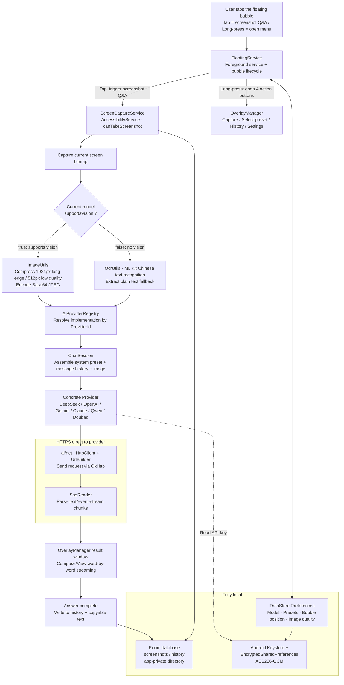

# [简体中文](README.md) | English
# Screenshot AI · Screenshot AI Assistant

> An always-on Android floating bubble: **tap to capture the screen, and AI streams back the answer**. Screenshot → send to a large language model → the answer appears word by word in a floating window, without interrupting what you're doing.
## 😋😋😋 Click to download now ---> [](https://github.com/MapleYazuu/Screenshot-Ai/releases) <--- Click to download now 😋😋😋
[](LICENSE)
[-3DDC84.svg?logo=android&logoColor=white)](https://developer.android.com/about/versions/11)
[](https://kotlinlang.org/)
[](https://developer.android.com/jetpack/compose)
[](https://github.com/MapleYazuu/Screenshot-AI/actions/workflows/android.yml)
[](https://github.com/MapleYazuu/Screenshot-Ai/releases)

<!--
  The CI badge is generated by .github/workflows/android.yml after pushing to main.
  The repository URL is also used by the app's "Check for updates" feature, defined in
  app/src/main/java/com/screenshot/ai/util/UpdateChecker.kt via GITHUB_OWNER / GITHUB_REPO.
  If you rename the repo, update all three places.
-->

**Screenshot AI (Screenshot AI Assistant)** is an open-source Android **always-on floating button** screenshot AI assistant. No cloud relay, no account system, no user-data collection — you bring your own API key, and screenshots are sent directly from your phone to the model provider you choose (BYOK, Bring Your Own Key).

---

## Table of Contents

- [Features](#features)
- [Screenshots](#screenshots)
- [Architecture](#architecture)
- [Tech stack](#tech-stack)
- [Project structure](#project-structure)
- [Build guide](#build-guide)
- [First-time setup / permissions](#first-time-setup--permissions)
- [API Key configuration (BYOK)](#api-key-configuration-byok)
- [Built-in presets](#built-in-presets)
- [Permissions](#permissions)
- [FAQ](#faq)
- [Contributing](#contributing)
- [License](#license)
- [Acknowledgments](#acknowledgments)

---

## Features

### Core interaction: tap to capture, long-press to open the menu

The floating bubble always stays on screen. There are only two gestures — nothing to memorize:

| Action | Behavior |
| --- | --- |
| **Tap the bubble** | Immediately captures the current screen → sends it to AI using the **current preset** → the answer **streams** into the floating result window |
| **Long-press the bubble** | Expands 4 action buttons: **Capture** / **Select preset** / **History** / **Settings** |
| **Drag the bubble** | Move it freely to any screen edge; the position is remembered |

The 4 actions after long-press:

| Button | Description |
| --- | --- |
| **Capture** | Manually triggers a screenshot + AI Q&A, equivalent to tapping the bubble |
| **Select preset** | Opens the preset list; picking one sets it as the default (a "+ New preset" entry sits at the bottom of the list) |
| **History** | Opens the Room history page to review past questions, screenshot thumbnails and AI answers |
| **Settings** | Bubble appearance, presets, model & API key, image quality, auto-start on boot, etc. |

## 📱 Screenshots

| Home | Demo | Button | Button expanded | App icon |
| :---: | :---: | :---: | :---: | :---: |
|  |  |  |  |  |

```text
docs/images/
├── home.jpg          # Home screen
├── effect.jpg        # Effect demo
├── button.jpg        # Floating bubble button
├── buttonunfold.jpg  # The 4 action buttons expanded by long-press
├── icon.png          # App icon
└── README.md         # Submission conventions for demo screenshots / GIFs
```

### Feature list

- 🎈 **Always-on floating bubble** — kept alive by a foreground service, doesn't occupy recent tasks, ready at any time.
- 📸 **One-tap screenshot** — captures the current screen via the accessibility service with `canTakeScreenshot="true"`; no root, no system permission dialog.
- 🖼️ **Multimodal direct send** — vision-capable models receive a Base64 JPEG directly (1024px max long edge; 512px in low-quality mode).
- 🔤 **Local OCR fallback** — models without vision automatically fall back to **ML Kit Chinese text recognition**; the extracted text is sent to the model, so text-only models also work.
- ⚡ **SSE streaming** — hand-written SSE parsing on top of OkHttp; answers appear word by word without waiting for the whole response.
- 🔌 **BYOK multi-provider** — **6** built-in providers (DeepSeek / OpenAI / Google Gemini / Anthropic Claude / Qwen / Doubao), all with customizable Base URL.
- 🧩 **Presets** — 5 built-in presets (translate / summarize / explain code / extract text / solve problems), fully editable, the first one is used by default.
- 🗂️ **Room history** — every Q&A (question, screenshot, answer, model, time) is stored locally; searchable, reviewable, deletable.
- ⚙️ **DataStore configuration** — all preferences (model, presets, bubble position, image quality, streaming toggle) are backed by DataStore Preferences.
- 🔐 **Encrypted keys** — API keys are encrypted with **AES256-GCM** using an Android Keystore master key and stored in EncryptedSharedPreferences; plaintext is never written to disk.
- 🚫 **Privacy first** — screenshots are written only to the app-private directory `filesDir/screenshots`, **never to the gallery**; backups are disabled in the Manifest.
- 🌙 **Compose main UI** — Home / History / Presets / Settings / About are all built with Jetpack Compose and follow the system dark mode.
- 🚀 **Optional auto-start on boot** — `RECEIVE_BOOT_COMPLETED` can be enabled to restore the bubble after a reboot.
- 🔋 **Battery optimization whitelist** — one-tap jump to `REQUEST_IGNORE_BATTERY_OPTIMIZATIONS` to reduce the chance of being killed in the background.
- 🔄 **Update check** — built-in `UpdateChecker` can check for new versions (no auto-download, no silent install).

---

## Architecture



Data flow highlights:

1. **Capture**: `FloatingService` tap → invokes `ScreenCaptureService` (accessibility service with `canTakeScreenshot="true"`) → obtains the current screen `Bitmap`.
2. **Route by model capability**: if `AiModel.supportsVision == true`, go through `ImageUtils` compression + Base64; otherwise go through `OcrUtils` (ML Kit Chinese recognition) and treat the text as input.
3. **Request**: `AiProviderRegistry` resolves the implementation by the current `ProviderId` → `ChatSession` packs the preset prompt, history context and image into `ChatMessage` → `HttpClient` sends the request.
4. **Streaming display**: `SseReader` parses `text/event-stream` chunk by chunk, and `OverlayManager` pushes incremental text to the window for word-by-word output.
5. **Persistence**: the result window writes to Room when done; configuration changes go to DataStore; API keys exist only in encrypted form inside EncryptedSharedPreferences.

Apart from the HTTPS requests made from `ai/net/`, **no data ever leaves the device**.

---

## Tech stack

| Module | Choice |
| --- | --- |
| Language | Kotlin 2.0.21 |
| Main UI | Jetpack Compose (Material 3, dark mode) |
| Floating window UI | Traditional View + XML + `WindowManager` (`TYPE_APPLICATION_OVERLAY`) |
| Screenshot | `AccessibilityService` + `takeScreenshot` (`canTakeScreenshot="true"`) |
| Network | OkHttp + hand-written SSE streaming parser (`SseReader`) |
| History persistence | Room |
| Configuration storage | DataStore (Preferences) |
| Key security | Android Keystore (AES256-GCM) + EncryptedSharedPreferences |
| Local OCR | ML Kit Chinese text recognition (fallback for non-vision models) |
| Image loading | Coil |
| Build system | Gradle Kotlin DSL + Version Catalog (`gradle/libs.versions.toml`) |
| Annotation processing | KSP 2.0.21-1.0.28 |
| Build toolchain | AGP 8.5.2 / Gradle 8.9 / JDK 17 |
| Version range | minSdk 30 (Android 11) / targetSdk 34 / compileSdk 34 |
| License | GNU General Public License v3.0 |

---

## Project structure

```text
screenshot-ai/
├── app/
│   └── src/
│       ├── main/
│       │   ├── java/com/screenshot/ai/
│       │   │   ├── ScreenshotAiApp.kt        # Application: initializes app-level dependencies
│       │   │   ├── ServiceLocator.kt         # Lightweight DI (DB / Repo / Prefs)
│       │   │   ├── ai/                       # AI abstraction layer
│       │   │   │   ├── AiProvider.kt         # Provider interface (chatStream / testConnection)
│       │   │   │   ├── AiModel.kt            # Model descriptor (id / display name / supportsVision / context window)
│       │   │   │   ├── ChatMessage.kt        # Message model (system / user / assistant + Base64 image)
│       │   │   │   ├── ChatSession.kt        # Session orchestration and cancellation
│       │   │   │   ├── StreamCallback.kt     # Streaming callbacks (onStart / onChunk / onComplete / onError)
│       │   │   │   ├── AiException.kt        # Unified exceptions (HttpError / NetworkError / ParseError …)
│       │   │   │   ├── AiProviderRegistry.kt # Provider registration and (Provider, Model) resolution
│       │   │   │   ├── net/                  # HttpClient.kt · UrlBuilder.kt · SseReader.kt
│       │   │   │   └── providers/            # 6 built-in providers + OpenAI-compatible base class + custom model
│       │   │   │       ├── OpenAiCompatibleProvider.kt  # Compatible protocol base (request assembly / auth / SSE parsing)
│       │   │   │       ├── DeepSeekProvider.kt
│       │   │   │       ├── OpenAiProvider.kt
│       │   │   │       ├── GeminiProvider.kt
│       │   │   │       ├── AnthropicProvider.kt         # The only independent implementation: /v1/messages
│       │   │   │       ├── QwenProvider.kt
│       │   │   │       ├── DoubaoProvider.kt
│       │   │   │       └── CustomProvider.kt            # Custom model (BYOK self-hosted gateway)
│       │   │   ├── service/                  # Background persistent services
│       │   │   │   ├── FloatingService.kt        # Floating bubble foreground service
│       │   │   │   ├── ScreenCaptureService.kt   # Accessibility screenshot service (canTakeScreenshot)
│       │   │   │   ├── OverlayManager.kt         # Creation and scheduling of all floating windows
│       │   │   │   ├── FloatingToolbarTileService.kt   # Quick Settings tile for the floating toolbar
│       │   │   │   ├── FloatingServiceController.kt    # Unified start/stop entry for the toolbar
│       │   │   │   └── BootReceiver.kt           # Auto-start on boot (optional)
│       │   │   ├── overlay/                  # Floating window Views (shared gesture base: WindowGestureBinder)
│       │   │   │   ├── OverlayBubbleView.kt          # The bubble itself
│       │   │   │   ├── OverlayBubbleContainerView.kt # Bubble window container
│       │   │   │   ├── OverlayActionPanelView.kt     # The 4 action buttons expanded by long-press (separate window)
│       │   │   │   ├── OverlayResultWindowView.kt    # Streaming result window (Markdown rendering + follow-up)
│       │   │   │   ├── OverlayHistoryPanelView.kt    # Floating history / preset picker panel
│       │   │   │   ├── OverlayCapturePreviewView.kt  # Screenshot preview
│       │   │   │   ├── OverlayPresetCreateView.kt    # "New preset" secondary dialog
│       │   │   │   ├── WindowGestureBinder.kt        # Unified drag / resize gesture state machine
│       │   │   │   └── MaxHeightScrollView.kt        # Height-adaptive scroll container
│       │   │   ├── ui/                       # Compose main UI
│       │   │   │   ├── main/                 # MainActivity / MainScreen / MainViewModel
│       │   │   │   ├── history/              # HistoryActivity / HistoryScreen / HistoryViewModel
│       │   │   │   ├── preset/               # PresetActivity / PresetScreen / PresetViewModel
│       │   │   │   ├── settings/             # SettingsActivity / SettingsScreen / SettingsViewModel
│       │   │   │   ├── about/                # AboutActivity / AboutScreen / AboutViewModel
│       │   │   │   ├── theme/                # Theme.kt · Shape.kt · Type.kt
│       │   │   │   └── common/               # CommonComponents.kt · LifecycleAwareDialog.kt
│       │   │   ├── data/                     # Data layer
│       │   │   │   ├── db/                   # AppDatabase.kt · HistoryDao.kt · HistoryRepositoryImpl.kt
│       │   │   │   ├── preset/               # PresetDao.kt · PresetRepositoryImpl.kt
│       │   │   │   ├── image/                # ImageStoreImpl.kt (writes to filesDir/screenshots)
│       │   │   │   ├── crypto/               # CryptoRepository.kt · CryptoRepositoryImpl.kt (Keystore)
│       │   │   │   ├── prefs/                # AppSettings.kt · SettingsRepository.kt (DataStore)
│       │   │   │   ├── model/                # HistoryItem.kt · Preset.kt
│       │   │   │   └── repo/                 # HistoryRepository.kt · ImageStore.kt · PresetRepository.kt
│       │   │   └── util/                     # Utilities
│       │   │       ├── ImageUtils.kt            # Scaling / compression / Base64 encoding
│       │   │       ├── OcrUtils.kt              # ML Kit Chinese text recognition
│       │   │       ├── PermissionUtils.kt       # Overlay / notification / battery whitelist jumps
│       │   │       ├── FloatingDragListener.kt  # Bubble drag and edge-snap gestures
│       │   │       ├── MarkdownRenderer.kt      # Unified Markwon rich-text rendering
│       │   │       ├── Haptics.kt               # Tap / long-press vibration feedback
│       │   │       ├── LocaleManager.kt         # Locale switching
│       │   │       ├── AiErrorMessages.kt       # AI exceptions → localized messages
│       │   │       ├── PromptTemplates.kt       # System prompt templates
│       │   │       ├── UpdateChecker.kt         # Version check
│       │   │       ├── TimeUtils.kt             # Time formatting
│       │   │       ├── ToastUtils.kt            # Unified toasts
│       │   │       └── UiPx.kt                  # Unified dp → px conversion
│       │   ├── res/                          # Resources: layout XML / icons / theme / localized strings (zh/en/ja/ko/ru)
│       │   └── AndroidManifest.xml
│       └── test/java/com/screenshot/ai/      # Unit tests
│           ├── ai/ProviderRegistryTest.kt · ai/SseParserTest.kt
│           ├── data/PresetRepositoryLogicTest.kt · data/CustomModelConfigTest.kt
│           └── util/ImageUtilsTest.kt · TimeUtilsTest.kt · UpdateCheckerTest.kt
├── docs/
│   ├── byok.md              # BYOK details and cost control
│   ├── adding-a-provider.md # How to add a new AI Provider
│   ├── api-key-security.md  # API key security strategy and threat model
│   └── images/              # Demo screenshots and GIFs (see docs/images/README.md)
├── gradle/
│   ├── libs.versions.toml   # Version Catalog
│   └── wrapper/             # Gradle 8.9 wrapper (Tencent Cloud mirror by default)
├── .github/
│   ├── workflows/android.yml      # CI: Debug build + tagged releases
│   ├── ISSUE_TEMPLATE/            # bug_report.yml · feature_request.yml · config.yml
│   └── PULL_REQUEST_TEMPLATE.md
├── CONTRIBUTING.md
├── LICENSE                  # GNU GPL v3.0
└── README.md
```

---

## Build guide

### Requirements

| Item | Required version |
| --- | --- |
| Android Studio | **Ladybug** (2024.2.1) or newer |
| JDK | **17** (required by AGP 8.5.2; JDK 21 also works but 17 is the reference) |
| Android SDK Platform | **API 34** (compileSdk / targetSdk) |
| Android Build Tools | 34.x (downloaded automatically by AGP) |
| Gradle | **8.9** (use the bundled wrapper, no manual installation needed) |
| Device OS | Android 11 (API 30) or newer |

> Android Studio downloads the required SDK Platform and Build Tools automatically. For command-line builds, make sure
> `ANDROID_HOME`, or `sdk.dir` in `local.properties`, points to an SDK directory with API 34 installed.

### Build steps

```bash
# 1. Clone the repository
git clone https://github.com/MapleYazuu/Screenshot-AI.git screenshot-ai
cd screenshot-ai

# 2. Build the Debug APK (gradlew.bat on Windows, ./gradlew on macOS/Linux)
./gradlew :app:assembleDebug

# 3. Run unit tests
./gradlew :app:testDebugUnitTest
```

Output path:

```text
app/build/outputs/apk/debug/app-debug.apk
```

Install on a connected device:

```bash
adb install -r app/build/outputs/apk/debug/app-debug.apk
```

> The Debug build's `applicationId` has a `.debug` suffix (`com.screenshot.ai.debug`), so it can be installed
> side-by-side with the Release build on the same device without overwriting it.

### Gradle distribution mirror (for mainland China networks)

The Gradle wrapper downloads distributions from `services.gradle.org` by default, which often times out on mainland China networks.
**This repository already defaults to a Tencent Cloud mirror**, so users in China can build directly **without any extra configuration**:

```properties
# gradle/wrapper/gradle-wrapper.properties
distributionBase=GRADLE_USER_HOME
distributionPath=wrapper/dists
distributionUrl=https\://mirrors.cloud.tencent.com/gradle/gradle-8.9-bin.zip
networkTimeout=10000
validateDistributionUrl=false
zipStoreBase=GRADLE_USER_HOME
zipStorePath=wrapper/dists
```

If you are **outside China** or prefer the official Gradle source, replace `distributionUrl` with the official address:

```properties
distributionUrl=https\://services.gradle.org/distributions/gradle-8.9-bin.zip
```

> ⚠️ Changing `gradle-wrapper.properties` is a local environment adjustment — **do not commit it to a PR**.
> CI runs on GitHub's machines; switching mirrors doesn't affect it but makes the diff noisy.

If dependency resolution (Maven Central / Google Maven) is also unstable, you can append mainland China mirror repositories
under `dependencyResolutionManagement` in `settings.gradle.kts`. **Likewise, do not commit repository configs that only work
on your local network** — if you must change it, explain it separately and make sure public CI still builds.

---

## First-time setup / permissions

Complete the following 7 steps in order to get started:

1. **Install the app**
   `adb install -r app-debug.apk`, or just tap the downloaded APK to install. The first launch opens the home screen.

2. **Grant the overlay permission (required)**
   Tap the "Overlay permission" guide item on the home page, jump to system settings → allow "**Display over other apps**"
   (`SYSTEM_ALERT_WINDOW`). Without this permission the bubble will not appear at all.

3. **Enable the accessibility service (required)**
   Tap the "Accessibility service" guide item → system settings → installed services → **Screenshot AI** → enable.
   This service declares `canTakeScreenshot="true"` and is the **only source of screenshot capability**. Without it, screenshots won't work.

4. **Grant the notification permission (required on Android 13+)**
   Android 13 and newer will prompt for `POST_NOTIFICATIONS`. The foreground service needs a persistent notification;
   denying it makes the service unstable or even reclaimable by the system.

5. **(Optional) Auto-start on boot + battery optimization whitelist**
   - Enable "Auto-start on boot" in Settings, and the bubble restores automatically after a reboot (`RECEIVE_BOOT_COMPLETED`).
   - Tap "Ignore battery optimizations" and choose "Allow" in the system dialog to reduce the chance of being killed in the background.

6. **Choose a provider and paste your API key**
   Settings → **AI Provider** → pick one of the 6 providers → select a model from the dropdown
   (models marked 👁 support vision) → paste your API key.
   The key is immediately encrypted with the Android Keystore; the settings page only shows a mask and never echoes plaintext.
   See [API Key configuration (BYOK)](#api-key-configuration-byok) for where to apply for keys.

7. **Test the connection**
   Settings → "**Test connection**". Success means the model is reachable; failure shows the HTTP status code.
   Check the 401 / 429 entries in the [FAQ](#faq) to troubleshoot.

After configuration, return to the home screen — the bubble should already be waiting at the screen edge. **Tap it and try.**

---

## API Key configuration (BYOK)

**BYOK = Bring Your Own Key.** This project provides no official API quota and no request relay.
You need to apply for a key on the provider's developer platform and pay for your own usage.

| Provider | Apply at | Default Base URL | Built-in models support vision? |
| --- | --- | --- | --- |
| **DeepSeek** | <https://platform.deepseek.com/api_keys> | `https://api.deepseek.com/` | `deepseek-flash` ✅ vision<br/>`deepseek-chat` ❌ text only<br/>`deepseek-reasoner` ❌ text only |
| **OpenAI** | <https://platform.openai.com/api-keys> | `https://api.openai.com/` | `gpt-4o` ✅ / `gpt-4o-mini` ✅ / `gpt-4-turbo` ✅<br/>`o3-mini` ❌ text only |
| **Google Gemini** | <https://aistudio.google.com/app/apikey> | `https://generativelanguage.googleapis.com/v1beta/openai/` | `gemini-1.5-flash` ✅ / `gemini-1.5-pro` ✅ / `gemini-2.0-flash` ✅ |
| **Anthropic Claude** | <https://console.anthropic.com/settings/keys> | `https://api.anthropic.com/` | `claude-3-5-sonnet-20241022` ✅ / `claude-3-5-haiku-20241022` ✅ / `claude-3-opus-20240229` ✅ |
| **Qwen** (DashScope) | <https://bailian.console.aliyun.com/?apiKey=1> | `https://dashscope.aliyuncs.com/compatible-mode/v1/` | `qwen-vl-max` ✅ / `qwen-vl-plus` ✅<br/>`qwen-plus` ❌ text only |
| **Doubao** (Volcano Ark) | <https://console.volcengine.com/ark> | `https://ark.cn-beijing.volces.com/api/v3/` | `doubao-vision-pro-32k` ✅ / `doubao-vision-lite-32k` ✅<br/>`doubao-pro-32k` ❌ text only |

**Protocol differences**: apart from Anthropic, which uses `/v1/messages`, the other 5 providers all use the OpenAI-compatible
`/chat/completions` endpoint, so adding a similar provider costs very little
(see [docs/adding-a-provider.md](docs/adding-a-provider.md)).

**Base URL is normalized automatically**: the defaults in the table work out of the box. `UrlBuilder` handles
trailing slashes and missing version segments uniformly:

| What you enter | Actual request URL |
| --- | --- |
| `https://api.deepseek.com/` | `https://api.deepseek.com/v1/chat/completions` |
| `https://api.deepseek.com` | `https://api.deepseek.com/v1/chat/completions` |
| `https://api.deepseek.com/v1` | `https://api.deepseek.com/v1/chat/completions` |
| `https://my-gw.example.com/v1/` | `https://my-gw.example.com/v1/chat/completions` |
| `https://my-gw.example.com/v1/chat/completions` | Used as-is |

So for a self-hosted gateway, you only need to fill in up to the **version segment**; a full URL won't be double-joined either.

### About key security

- ✅ API keys are encrypted locally with an **Android Keystore master key + AES256-GCM** and stored in
  EncryptedSharedPreferences; **plaintext is never written to disk**.
- ✅ Keys are **never** uploaded to any server of this project (this project has no server at all).
- ✅ Keys only appear in the HTTPS request headers sent to **the provider you chose**.
- ⚠️ In other words: **apart from the one model provider you configure, no third party can obtain your key.**
- ⚠️ On rooted devices or devices injected by malicious apps, the protection of local encryption degrades significantly.
  See [docs/api-key-security.md](docs/api-key-security.md) for the full threat-model analysis.
- ⚠️ Cloud backup is **disabled** in the Manifest (`allowBackup="false"`), so ciphertext cannot leak via system backups either.

For more details on application steps, quota notes, custom Base URL usage and cost-control tips, see
**[docs/byok.md](docs/byok.md)**.

---

## Built-in presets

5 built-in presets; the first one, **"Translate"**, is the default. You can add, edit, delete and reorder
presets in Settings, or switch temporarily from the floating menu's "Select preset" entry.

| # | Name | Purpose | Typical scenario |
| --- | --- | --- | --- |
| 1 | **Translate** (default) | Recognize all text in the screenshot and translate it into Chinese | English documents, Japanese UIs, foreign apps |
| 2 | **Summarize** | Summarize the main content of the screenshot and extract key information | Quickly grasp long articles, announcements, chat logs |
| 3 | **Explain code** | Explain what the code in the screenshot does and how it works | Reading open-source code, reading error stack traces |
| 4 | **Extract text** | Extract text verbatim, preserving paragraph formatting, without extra interpretation | Copying unselectable text, receipt information |
| 5 | **Solve problems** | Give the approach first, then detailed steps and the final answer | Math problems, multiple-choice questions, homework help |

> With non-vision models, presets 1 / 4 still work — the input is provided by ML Kit's local OCR.

---

## Permissions

| Permission | Purpose | Required? |
| --- | --- | --- |
| `SYSTEM_ALERT_WINDOW` | Shows the bubble, action menu and result window (`TYPE_APPLICATION_OVERLAY`) | ✅ **Required** |
| `BIND_ACCESSIBILITY_SERVICE`<br/>(accessibility service, `canTakeScreenshot="true"`) | Captures the current screen; the only source of screenshot capability | ✅ **Required** |
| `FOREGROUND_SERVICE` | Runs persistently as a foreground service so the system doesn't reclaim it at will | ✅ **Required** |
| `FOREGROUND_SERVICE_SPECIAL_USE` | Android 14+ requires foreground services to declare a concrete type | ✅ **Required** |
| `POST_NOTIFICATIONS` | Shows the persistent foreground-service notification | ✅ **Required** (runtime request on Android 13+) |
| `INTERNET` | Accesses the AI provider endpoints you configure over HTTPS | ✅ **Required** |
| `RECEIVE_BOOT_COMPLETED` | Restores the bubble automatically after boot | ⭕ Optional (Settings toggle) |
| `REQUEST_IGNORE_BATTERY_OPTIMIZATIONS` | Guides the user to whitelist the app from battery optimization | ⭕ Optional |
| `QUERY_ALL_PACKAGES` | Queries component visibility when jumping to vendor settings pages | ✅ Declared (with `tools:ignore`) |

Permissions that are **not requested** (verify in `AndroidManifest.xml` yourself): read/write external storage or gallery,
contacts, location, SMS, `READ_LOGS`, etc. Screenshots are written only to the app-private directory.

---

## FAQ

<details open>
<summary><b>Q1. The bubble is gone / never appears. What do I do?</b></summary>

Troubleshoot in this order:

1. **Overlay permission**: Settings → Apps → Special app access → Display over other apps → allow Screenshot AI.
   This is the most common cause; without it, `WindowManager.addView` throws immediately.
2. **Is the service still alive**: open the app's home screen and check whether the bubble toggle is on; after being killed by the system, it needs to be restarted.
3. **Did it slide off-screen**: the bubble supports drag-and-snap to edges; in rare cases it can end up under the status/navigation bar. Restarting the service returns it to the default position.
4. **Vendor background restrictions**: see Q6 — Xiaomi / Huawei / OPPO / vivo need extra auto-start and background whitelist settings.
5. **Notification permission denied**: on Android 13+, denying notifications destabilizes the foreground service; please grant `POST_NOTIFICATIONS`.
</details>

<details>
<summary><b>Q2. Tapping the bubble fails to capture and shows "Capture failed". What do I do?</b></summary>

Screenshots depend on the accessibility service. Check in order:

1. **Is the accessibility service enabled**: Settings → Accessibility → Installed services → Screenshot AI → enable.
   System upgrades, force-stops, or certain cleaner apps can disable it.
2. **Was the service reclaimed by the system**: re-enter the app and enable the bubble once.
3. **Are you on a protected screen**: some system screens (e.g., payment password pages, `FLAG_SECURE` banking / video app screens)
   are **actively blocked from screenshots by the system** — no app can capture them in that case. That's system behavior, not a bug.
4. **Are you in split-screen / picture-in-picture**: on some ROMs, `takeScreenshot` returns an error code in split-screen mode.
</details>

<details>
<summary><b>Q3. What do 401 / 403 / 429 mean?</b></summary>

| Status | Meaning | What to do |
| --- | --- | --- |
| **401** Unauthorized | API key invalid, mistyped, deleted or expired | Re-paste the key in Settings; don't copy the `Bearer ` prefix or quotes along with it |
| **403** Forbidden | Key valid but no permission for that model; or the model isn't enabled / identity not verified | Enable the model in the provider console, or switch models |
| **404** Not Found | Wrong Base URL or model name | Check the Base URL against the [BYOK table](#api-key-configuration-byok); Volcano Ark needs the correct endpoint/model name |
| **429** Too Many Requests | Rate limited or **insufficient balance** | Reduce request frequency; check quota and billing in the provider console; paid accounts usually recover immediately |
| **5xx** | Provider server error | Retry later; temporarily switch to another provider |

All errors include the provider's original message — use that text as the source of truth when debugging.
</details>

<details>
<summary><b>Q4. What happens if I use a non-vision model (like <code>deepseek-chat</code>)?</b></summary>

No error, and the image is not sent. The app **degrades automatically**:

1. Detects `AiModel.supportsVision == false`;
2. Runs local **ML Kit Chinese text recognition** to extract text from the screenshot;
3. Sends "preset + extracted text" to the model as a plain-text message.

So text-only models work too, but the ceiling depends on OCR quality: **charts, formulas, handwriting and complex layouts degrade noticeably**.
If you mainly read images, charts and UI layouts, pick a vision model marked ✅ in the table.
</details>

<details>
<summary><b>Q5. Will my screenshots be uploaded? Will they enter the gallery?</b></summary>

Two separate answers:

- **Local storage**: screenshots are written only to the app-private directory `filesDir/screenshots`, **never to the gallery or external storage**,
  so other apps can't read them; the Manifest sets `allowBackup="false"`, so cloud backup is also disabled.
- **Network**: **the screenshot is indeed sent to the AI provider you configured** (that's how this app works).
  Vision models receive Base64 images; non-vision models receive the text extracted by local OCR.
  Apart from that, **no other server receives your data** — this project has no relay server and no analytics SDK.

> ⚠️ Do not capture and send screens containing ID numbers, bank cards, passwords, trade secrets or other sensitive content.
> Once data is sent to a third-party model provider, it is governed by that provider's privacy policy, which this project cannot control.
</details>

<details>
<summary><b>Q6. Background kills / bubble drops on Xiaomi / Huawei / OPPO / vivo. What do I do?</b></summary>

Domestic ROMs manage background apps aggressively; you need to whitelist manually:

- **Xiaomi / Redmi (MIUI / HyperOS)**: Settings → Apps → Manage apps → Screenshot AI →
  enable **Auto-start**, set **Battery saver** to "No restrictions", and **lock the background task** (pull down the task in recents and lock it).
- **Huawei / Honor (EMUI / HarmonyOS)**: Settings → Apps → App launch → turn off "Manage automatically",
  manually check **Auto-start / Secondary launch / Background activity**; then Battery → More battery settings → lift the "keep network during sleep" restriction.
- **OPPO / OnePlus (ColorOS)**: Settings → Battery → App battery management → Screenshot AI → allow **Background running** +
  **Auto-start**; **lock** the app in recents.
- **vivo (OriginOS)**: Settings → Battery → Background high power consumption → allow Screenshot AI;
  i Manager → Auto-start management → enable.
- **General tips**: tap "Ignore battery optimizations" in the app's settings and allow it; keep the app out of the
  "Don't keep activities" list in developer options; don't use cleaner apps' one-tap background cleanup.

Even with all of the above, an app unused for a long time may still be reclaimed — reopen the app to restore the bubble.
</details>

<details>
<summary><b>Q7. Are custom API relays / proxies / self-hosted gateways supported?</b></summary>

Yes. The Settings page lets you override the **Base URL** and point it at any OpenAI-compatible relay, reverse proxy or self-hosted gateway.
Fill in up to the version segment (e.g. `https://your-gateway.example.com/v1/`) and the app appends `/chat/completions` automatically;
pasting the full URL won't be double-joined either.
Note: a relay can see both your key and your screenshots — evaluate the trust yourself.
See [docs/byok.md](docs/byok.md) for details.
</details>

<details>
<summary><b>Q8. Why Android 11+ only?</b></summary>

The project uses the accessibility service's `takeScreenshot()` API (introduced in API 30) and `FOREGROUND_SERVICE_SPECIAL_USE`
(mandated by Android 14), so `minSdk` is set to 30. Older versions have no stable root-free screenshot approach.
</details>

---

## Contributing

Issues and PRs are welcome! Please read **[CONTRIBUTING.md](CONTRIBUTING.md)** first; it covers:

- Dev environment setup and common Gradle commands
- Branching model and commit message conventions (Conventional Commits, with Chinese examples)
- Code style (4-space indentation, 120 columns, Chinese comments, `.editorconfig` + `./gradlew ktlintCheck`)
- Step-by-step guide on **how to add a new AI Provider** (see also [docs/adding-a-provider.md](docs/adding-a-provider.md))
- Test requirements, PR workflow and issue conventions

Other related documents:

| Document | Contents |
| --- | --- |
| [CONTRIBUTING.md](CONTRIBUTING.md) | Contribution guide |
| [SECURITY.md](SECURITY.md) | Vulnerability reporting process and design trade-offs that don't need reporting |
| [docs/byok.md](docs/byok.md) | BYOK details, key application, error code reference, cost control |
| [docs/adding-a-provider.md](docs/adding-a-provider.md) | Multi-provider extension: full code examples and caveats |
| [docs/api-key-security.md](docs/api-key-security.md) | API key security strategy and threat model |
| [docs/images/README.md](docs/images/README.md) | Submission conventions for demo screenshots / GIFs |

---

## License

This project is released under the **GNU General Public License v3.0**; see [LICENSE](LICENSE) for the full text.

In short:

- ✅ You may freely **use, modify and distribute** this project, including commercial use.
- ✅ When distributing a modified version, you **must open-source it under GPLv3 as well** and provide the complete source code.
- ✅ You must retain the copyright notice and license notice, and **state what you changed**.
- ❌ You may not **close-source** and distribute this project (or derivatives of it).
- ❌ No warranty is provided (see sections 15 and 16 of the license).

> This is a personal open-source project with **no affiliation or sponsorship** with DeepSeek, OpenAI, Google, Anthropic,
> Alibaba Cloud, Volcano Engine or any other vendor; all trademarks belong to their respective owners.

---

## Acknowledgments

- Thanks to **Jetpack Compose**, **OkHttp**, **Room**, **DataStore**, **Coil**, **ML Kit** and other open-source projects,
  and to the Google and Square teams for the excellent infrastructure.
- Thanks to **DeepSeek / OpenAI / Google Gemini / Anthropic / Qwen / Doubao** for their model services and OpenAI-compatible
  APIs, which let the BYOK model support multiple providers with minimal adaptation cost.
- Thanks to everyone who filed issues, reported problems, and contributed code and documentation.

---

<div align="center">

**Developed by [MapleYazuu](https://github.com/MapleYazuu), open-sourced under GPLv3, maintained with the community.**

If this project helps you, a ⭐ star is welcome.

</div>
